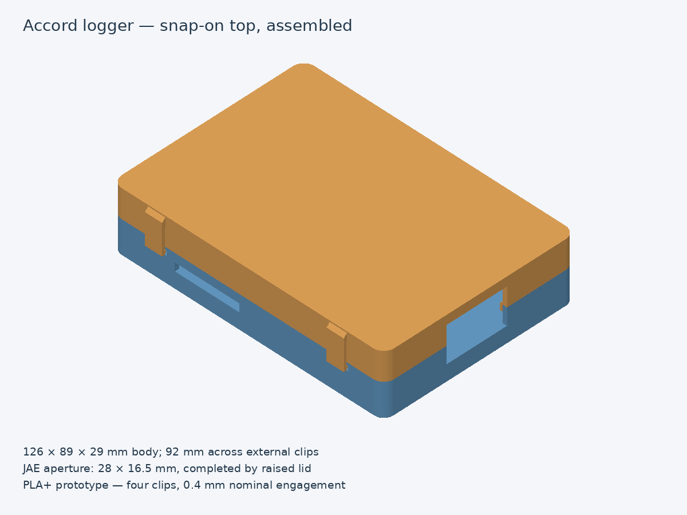

# Logger snap-on enclosure — PLA+ prototype

A raised lid completes the IL-AG5 connector opening and snaps onto a revised
bottom with four latch windows (owner request D-CASE-37, November 12, 2026).
Use **both parts from this directory**: the earlier `case-bottom` tray does
not have the receivers needed for these clips.



## Files

- **[accord-logger-bottom.stl](accord-logger-bottom.stl)**: matching bottom,
  flat underside at Z=0, ready to import into a slicer in millimetres.
- **[accord-logger-top.stl](accord-logger-top.stl)**: lid already flipped
  roof down, with its outer roof at Z=0, for printing.
- **[accord-logger-top-assembled.stl](accord-logger-top-assembled.stl)**:
  the same lid in assembly coordinates; use with the bottom for CAD viewing.
  This is an alternate orientation, not a third part to print.
- **[accord-logger-enclosure.scad](accord-logger-enclosure.scad)**: editable
  lid and mating geometry, with `part` selecting `top`, `bottom`, `assembled`
  or `exploded`. Imports the earlier bottom STL as its blank; keep the
  neighbouring `case-bottom` directory when copying the source.
- **[exploded-preview.png](exploded-preview.png)** and
  **[top-print-preview.png](top-print-preview.png)**: actual mesh views.
- **[dimensions.json](dimensions.json)**: dimensions, source/output hashes
  and exported-mesh validation results.

## Dimensions and openings

| Feature | Dimension |
|---|---:|
| Assembled body | 126 × 89 × 29 mm |
| Including external clips | 126 × 92 × 29 mm |
| Bottom rim / lid seam | Z=16 mm |
| Lid sidewalls / roof | 2 / 2 mm |
| Roof underside | Z=27 mm |
| PCB underside / top | Z=7.175 / 8.775 mm |
| Alignment skirt | 3 mm insertion, 1 mm thick |
| Skirt clearance to bottom wall | 0.3 mm per side |
| Complete JAE opening | 28 mm wide × 16.5 mm high |
| JAE opening limits | Y=26..54, Z=8.275..24.775 mm |

The lid rises 13 mm above the original rim. Its upper JAE notch meets the
bottom notch at Z=16 without a crossbar. The alignment skirt is also removed
across this opening. There is 2.225 mm of solid wall above the aperture before
the roof underside, and 2 mm of roof above that. The width and height retain
the previous catalogue-based allowances; see the
[bottom's dimension derivation](../case-bottom/README.md#jae-reference-and-top-open-notch).
Harness-plug latch operation and actual fitted component heights still need
checking on the assembly.

The original SD window stays 29.8 × 3.75 mm. Its top is Z=12.025; the skirt
ends at Z=13, leaving 0.975 mm between them. The owner-selected SD position
remains provisional, directly above the PCB. The skirt projects 0.3 mm inward
past the PCB outline, starting 4.225 mm above the PCB top; check tall edge
components against it. The four stepped studs, 3.175 mm support height,
2 mm bottom walls, 4 mm floor and 1 mm bottom chamfer are preserved.

## Snap mechanism and first fit

Four external cantilever clips are integral to the lid, two each on the front
and back walls at X=18 and 102 mm. They are outside the PCB cavity and avoid
the SD opening. Each beam is 8 mm wide and 1.2 mm thick, with a 0.6 mm inside
root radius and approximately 10 mm of flexible length above the hook.
A sloping outer root reduces the overhang when printed roof down.

The hook has a lead-in ramp and projects 0.4 mm into the bottom's wall. It
catches under the top of a 9 mm-wide receiver window at Z=12.6..14.8. The
retaining face is at Z=14.6, leaving 0.2 mm vertical play. The beam itself
stands 0.3 mm away from the outside wall. Nominal required outward movement
to pass the wall is 0.4 mm. To remove the lid, ease the exposed clip tips
outwards while lifting; avoid forcing the lid upward against engaged hooks.

These dimensions are starting choices for the owner's **PLA+**, not a
material qualification or a measured printer fit. Try the empty case first,
checking that the clips move freely, all four latch, and can be released
without damage. Review the sliced 1.2 mm beams, 0.3 mm gaps and window bridges;
keep supports out of the clip gaps. Roof-down printing puts the long clip
axes across layers, so layer adhesion and repeated flexing need particular
attention. Reduce hook engagement if the first fit requires excessive force.

The general cantilever mechanism and the importance of print orientation and
fit tolerances follow [Formlabs' snap-fit design guide](https://formlabs.com/blog/designing-3d-printed-snap-fit-enclosures/).
That guide does not validate this geometry or the owner's particular PLA+.
No print, force, fatigue, or populated-board fit test has been performed.

## Regenerate and adjust

With NumPy, Manifold3D 3.5.4 and Pillow available:

```sh
python3 logger/hardware/kicad/tools/build_case_enclosure.py --preview
```

`--engagement` adjusts the hook intrusion (default 0.4 mm, supported prototype
range 0.1–0.6). `--lip-clearance` adjusts the skirt's radial clearance (default
0.3 mm, range 0.2–0.5). For example:

```sh
python3 logger/hardware/kicad/tools/build_case_enclosure.py --engagement 0.3 --preview
```

The equivalent parameters are at the top of the OpenSCAD file. Other lid and
clip dimensions can be edited in the model or generator. Regeneration replaces
this directory's generated files; preserve custom source edits separately.
The tool expects the approved 126 × 89 × 16 mm base and current connector
positions. If changing the PCB or base dimensions, regenerate the reference
and base first, then review this mating design before adjusting its guards.
OpenSCAD is not installed on the generation host, so the SCAD source has not
been rendered there; the supplied STL geometry is generated with Manifold3D.

The generator reloads all three exported binary STLs, checks paired oriented
edges, nondegenerate triangles, expected topology and one connected solid
per part. Boolean checks confirm essentially zero closed-assembly overlap,
clear SD/JAE apertures, an intact JAE upper bridge, and unchanged lower
geometry including studs. Exactly 158.4 mm³ is removed from the earlier
bottom for four latch windows. Each hook intersects the original wall only
inside its receiver, catches the upper rail when lifted 0.5 mm, and clears it
after an outward movement of engagement plus 0.1 mm. These are rigid geometry
checks, not a simulation of clip stresses or insertion force. The exported
print lid starts at Z=0. Float32 mesh checks allow 0.0001 mm³ residual volume
at coincident cut faces. Independent sections at Z=13.1 and 15.9 confirm
the 0.3 mm skirt gap; reversing the print orientation matches assembly
vertices within 0.00001 mm. Both extremes of the exposed fit-adjustment
ranges also pass the geometry checks.

Based on Accord by Jayson Gazeley — https://github.com/jgazeley/accord.
The design and generated representations use CERN-OHL-P-2.0; see
[LICENSE](../../LICENSE) and [NOTICE](../../NOTICE). This README and the
Python generator use Apache-2.0.
